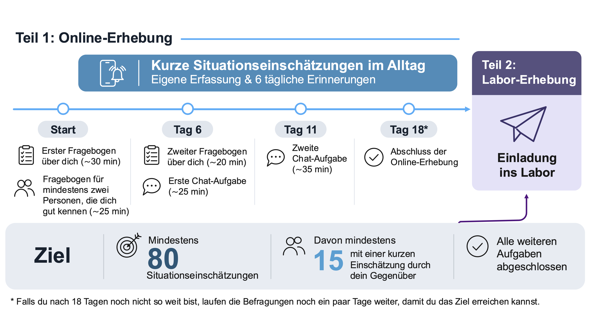

Willkommen! Auf dieser Seite findest du die wichtigsten Informationen zur PerSoDyn-Studie.

## Allgemeines zur Studie

### Worum geht es in der Studie?

PerSoDyn ist ein Forschungsprojekt der Universität Münster. Wir möchten besser verstehen, wie Menschen ihre sozialen Begegnungen im Alltag erleben und wie sie sich dabei verhalten.

### Wer führt die Studie durch?

Die Studie wird an der Universität Münster von der Arbeitseinheit für Psychologische Diagnostik und Persönlichkeitspsychologie unter der Projektleitung von Dr. Niclas Kuper im Rahmen eines von der Deutschen Forschungsgemeinschaft (DFG) geförderten Projekts durchgeführt.

## Teilnahme

### Wer kann teilnehmen?

Teilnehmen können Personen, die **18 bis 35 Jahre alt** sind, **Deutschkenntnisse auf Muttersprachniveau** und ein **eigenes Smartphone** haben. Wenn du im Masterstudiengang Klinische Psychologie und Psychotherapie (KliPPT) studierst, darfst du dich noch nicht im dritten oder einem höheren Semester befinden.

[Hier](https://studien.uni-muenster.de/persodyn-signup?_new_session=1){target="_blank"} kannst du dich für die Teilnahme an der Studie anmelden.

### Wie läuft die Studie ab?

Die Studie besteht aus **zwei Teilen**: der Online-Erhebung und der anschließenden Labor-Erhebung.

1. **Online-Erhebung** 
    - **Zwei Fragebögen über dich:** Du beantwortest Fragen zu deiner Persönlichkeit, deinem Wohlbefinden, deinen Einstellungen und deinem Sozialleben. Den ersten Fragebogen (ca. 30 min) beantwortest du zu Beginn der Studie, den zweiten (ca. 20 min) später im Verlauf der Smartphone-Phase.
    - **Fragebogen für zwei Personen, die dich gut kennen:** Du leitest einen Fragebogen (ca. 25 min) an mind. zwei Personen weiter, die dich gut kennen. Ab der dritten Person, die den Fragebogen über dich ausfüllt, erhältst du für jede weitere Person ein Los für unser [Gewinnspiel](#gewinnspiel). 
    - **Smartphone-Phase** (18 Tage, bei Bedarf länger): Nach sozialen Interaktionen startest du selbst in der App einen Fragebogen zu der Situation, das dauert jeweils nur wenige Minuten. Zusätzlich erhältst du sechsmal täglich eine Erinnerung, damit keine Interaktion verloren geht. 
    - **Einschätzungen deines Gegenübers:** Nach einer Interaktion kannst du deinem Gegenüber einen QR-Code zeigen oder einen Link schicken, über den die Person kurz einschätzt, wie sie die Situation erlebt hat.
    - **Ziel:** mindestens **80 ausgefüllte Fragebögen** zu sozialen Interaktionen, davon mindestens **15** mit einer Einschätzung deines Gegenübers. Falls du dieses Ziel nach 18 Tagen noch nicht erreicht hast, laufen die Befragungen weiter. Insgesamt hast du dafür bis zu 40 Tage Zeit. Ab der 16. Einschätzung deines Gegenübers erhältst du für jede Einschätzung ein Los in unserem [Gewinnspiel](#gewinnspiel).
    - **Chats mit KI:** Zu zwei verschiedenen Zeitpunkten während der Smartphone-Phase führst du mehrere kurze Chats mit KI-Sprachmodellen (insgesamt ca. 1 Stunde).
2. **Labor-Erhebung** 
    - Wenn du alle vorherigen Aufhaben erledigt hast, laden wir dich ins Labor ein. Die Labor-Erhebung findet in der Limette, Malmedyweg 19, 48149 Münster, statt und dauert ca. **1,5 bis 2 Stunden**. Dabei werden Video- und Tonaufnahmen gemacht.

{width=100%}

### Kann ich die Teilnahme abbrechen?

Ja. Die Teilnahme ist freiwillig und du kannst jederzeit ohne Angabe von Gründen aufhören. Bitte schreibe uns dazu eine E-Mail an [persodyn@uni-muenster.de](mailto:persodyn@uni-muenster.de).

## Vergütung {#verguetung}

Für die vollständige Teilnahme an allen Bestandteilen der Studie erhältst du **100 €**. Wenn du nicht an der Labortestung teilnimmst, kannst du anteilig für die absolvierten Studienkomponenten vergütet werden (maximal 20€, dafür bitte per E-Mail an uns wenden).

Psychologie- und Sportstudierende können stattdessen bis zu **10 Versuchspersonenstunden (VP-Stunden)** erhalten. Wenn sie alle Studienbestandteile absolvieren, bekommen sie zusätzlich **20 €**.

### Gewinnspiel {#gewinnspiel}

Wir verlosen **50 Wunschgutscheine im Wert von jeweils 50 €**. Du nimmst automatisch teil, sobald mehr als zwei Personen den "Fragebogen für Personen, die dich gut kennen" ausgefüllt haben oder du mehr als 15 Situationseinschätzungen von deinem Gegenüber eingeholt hast. Lose aus beiden Aufgaben zählen zusammen. Je mehr Lose du sammelst, desto höher ist deine Gewinnchance.

## Informationen für Personen, die einen Fremdbericht ausfüllen {#fremdberichte}

### Warum wurde ich gebeten, einen Fragebogen auszufüllen?

Eine Person, die an unserer PerSoDyn-Studie teilnimmt, hat dich gebeten, einen Fragebogen über sie auszufüllen. Einen solchen Fragebogen nennen wir **Fremdbericht**. Darin schätzt du die Person aus deiner Sicht ein.

In der Studie untersuchen wir, wie Menschen soziale Begegnungen erleben und wie sie sich in unterschiedlichen Situationen verhalten. Mehr zum Forschungsprojekt findest du unter [Allgemeines zur Studie](#allgemeines-zur-studie).

### Verlosung

Personen, die einen Fremdbericht ausfüllen, können an unserer **Verlosung von 50 Wunschgutscheinen im Wert von jeweils 50 €** teilnehmen. Die Teilnahme an der Verlosung ist freiwillig. Weitere Informationen zur Teilnahme an der Verlosung erhältst du im Fragebogen.

### Kann ich auch selbst an der Studie teilnehmen?

Ja! Wenn du selbst an der vollständigen Studie teilnehmen möchtest, musst du **18 bis 35 Jahre alt** sein, **Deutschkenntnisse auf Muttersprachniveau** und ein **eigenes Smartphone** haben. Studierst du im M.Sc. Psychologie mit dem Schwerpunkt "Klinische Psychologie und Psychotherapie", kannst du nur teilnehmen, wenn du noch nicht im dritten oder einem höheren Semester bist.

Für die vollständige Studienteilnahme erhältst du **100 €**. Psychologie- und Sportstudierende können stattdessen bis zu **10 VP-Stunden und zusätzlich 20 €** erhalten, wenn sie alle Studienbestandteile absolvieren. Informationen zum Ablauf der Studie findest du unter [Wie läuft die Studie ab?](#wie-läuft-die-studie-ab).

[Hier](https://studien.uni-muenster.de/persodyn-signup?_new_session=1){target="_blank"} kannst du dich für die Studie anmelden.

## Weitere Informationen

Alle wichtigen Informationen zur Teilnahme und zum Umgang mit deinen Daten findest du in unserer **Teilnahme- und Datenschutzinformation** (Link folgt). Dort kannst du dich ausführlicher über die Studie informieren.

## Kontakt

Bei Fragen erreichst du das Studienteam unter [persodyn@uni-muenster.de](mailto:persodyn@uni-muenster.de).

## Hilfestellungen für die Installation der Studien-App

Bei unserer Studien-App handelt es sich um eine WebApp. Sie wird daher nicht wie eine gewöhnliche App aus dem App Store oder Google Play Store installiert. Stattdessen wird sie über den Browser aufgerufen und kann anschließend auf dem Startbildschirm deines Handys abgelegt werden.

### Ich finde die App nicht auf meinem Startbildschirm.

Suche nicht nur auf deinem Startbildschirm, sondern auch unter „allen Apps“. Du kannst auch über die Suchfunktion deines Handys nach „PerSoDyn“ suchen. Falls möglich, lege die WebApp anschließend auf dem Startbildschirm ab.

### Ich kann die App nicht installieren, es passiert nichts.

- Da es sich um eine WebApp handelt, kann die Einrichtung je nach Handy und Internetverbindung einige Minuten dauern. Bitte warte zunächst einige Minuten. Sollte innerhalb dieser Zeit nichts passieren, versuche die Einrichtung erneut.
- Achte außerdem darauf, dass du eine stabile Internetverbindung hast und du die Einrichtung über einen unterstützten Browser (Safari, Google Chrome) durchführst.
- Bei Android-Geräten kann es in Einzelfällen vorkommen, dass die Installation erst über Nacht abgeschlossen wird, ohne dass währenddessen ein Fortschritt angezeigt wird.
- Wenn die Einrichtung auch nach mehreren Versuchen nicht funktioniert, wende dich bitte per E-Mail an uns.

### Ich bekomme keine Testbenachrichtigungen.

Wenn du keine Benachrichtigungen von der Studien-App erhältst, überprüfe bitte zunächst die folgenden Einstellungen:

1. **„Nicht stören“ überprüfen:** Stelle sicher, dass sich dein Handy nicht im „Nicht stören“-, „Energiespar“- oder einem vergleichbaren Modus befindet. Solche Einstellungen können Benachrichtigungen blockieren oder stummschalten.
2. **Benachrichtigungen für deinen Browser überprüfen:** Öffne die Einstellungen deines Handys und suche nach dem Browser, den du für die Studien-App verwendest. Überprüfe, ob Benachrichtigungen für diesen Browser zugelassen sind.
3. **Benachrichtigungen in den Browser-Einstellungen überprüfen:** Öffne anschließend deinen Browser und gehe in dessen Einstellungen. Überprüfe, ob Benachrichtigungen für die Studien-App bzw. die Webseite der Studie zugelassen sind.
4. Testbenachrichtigung erneut erzeugen.

### Ich habe alle Schritte ausprobiert, aber es funktioniert trotzdem nicht.

Danke, dass du bis hierhin durchgehalten hast. Leider gibt es einzelne Fälle, in denen die Installation der App und das sichere Zustellen der Benachrichtigungen nicht funktioniert.
Bitte wende dich mit einer kurzen E-Mail an [persodyn@uni-muenster.de](mailto:persodyn@uni-muenster.de), wir finden eine Alternativlösung!
